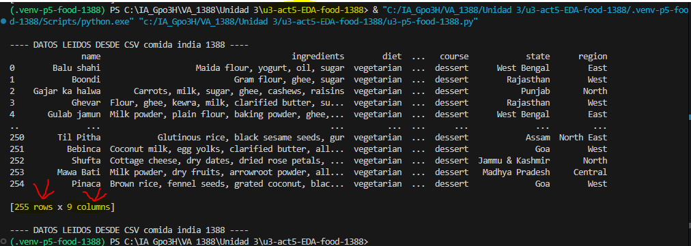
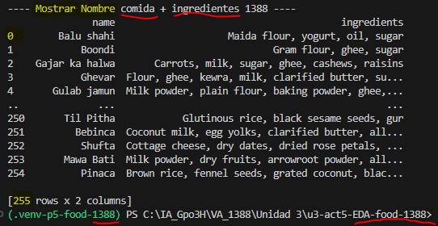
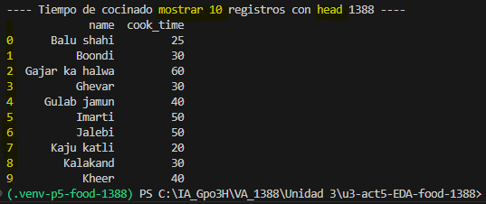
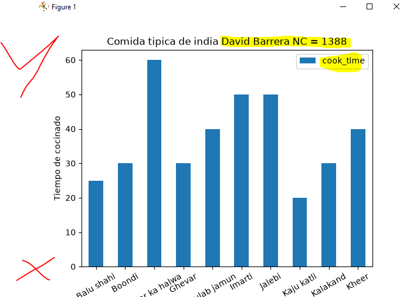
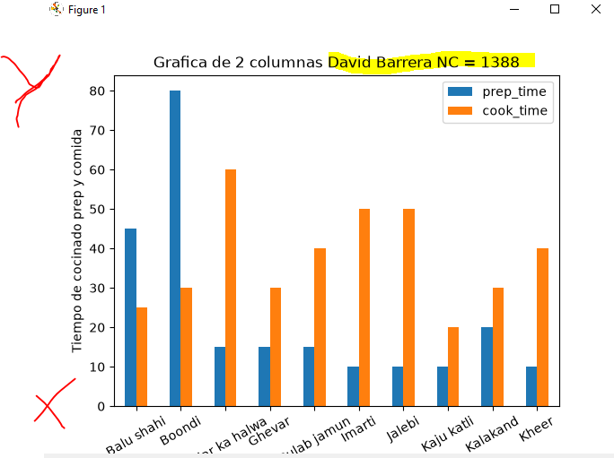
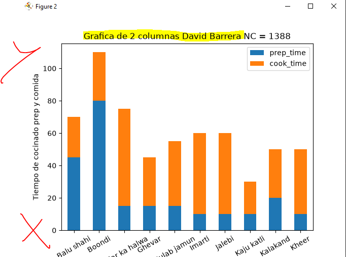

## Analisis exploratorio de datos
## comida del pais India
## David Barrera NC = 1388
### -+-+- importando datos del csv comida india -+-+-

### -+-+- Mostrar Nombre comida + ingredientes

### Tiempo de cocinado, mostrar 10 registros con head

### Creacion de grafica de barras pandas NC = 1388

### Grafica de varias columnas

### Grafica apilada
